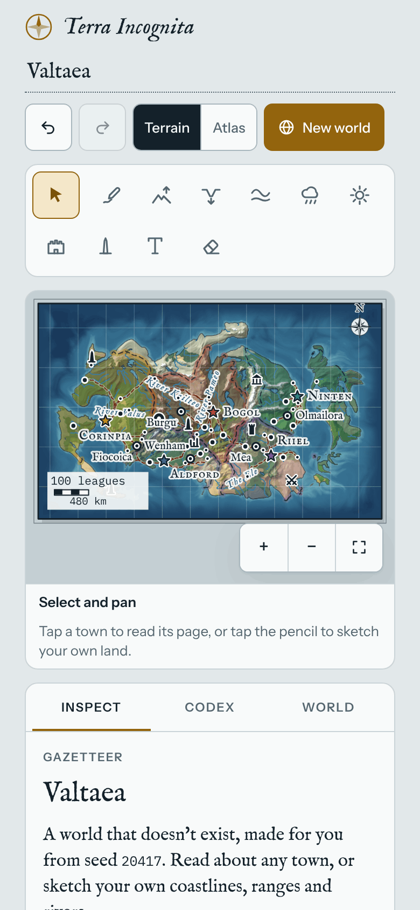
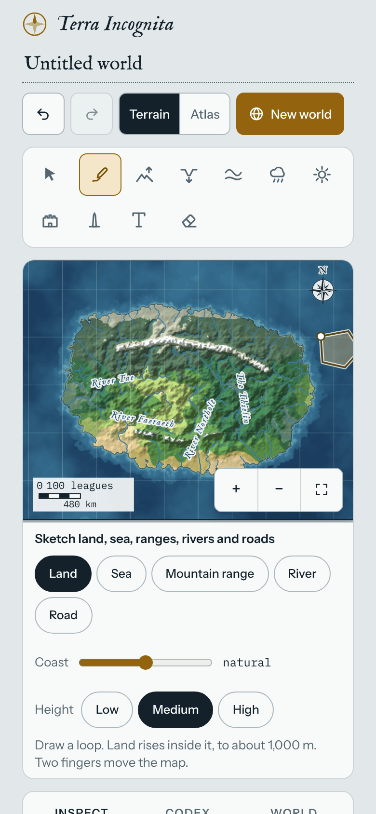
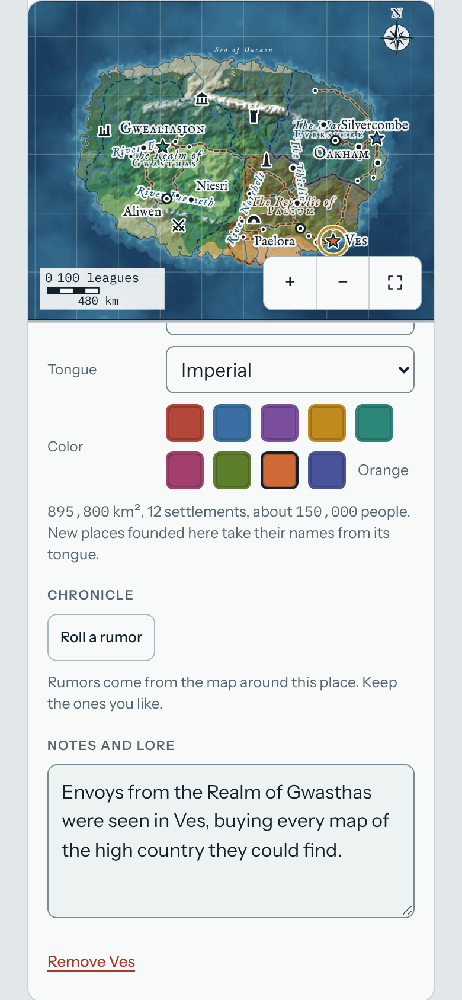

# Terra Incognita

**Play it: [terra-incognita.junkdrawer.works](https://terra-incognita.junkdrawer.works/)**

**Make a map of a world that doesn't exist.** Roll a random world, or start from blank ocean and sketch one yourself:
coastlines, mountain ranges and rivers, drawn with a finger or a mouse. Rain runs downhill, so rivers and lakes form on
their own, the climate decides where forest and desert go, and realms spread out from their capitals until mountains
and sea stop them. Every town has a page for its story.

<p align="center">
  
  &nbsp;
  
  &nbsp;
  
</p>

## How it plays

- **Sketch.** *Land*: draw a loop and land rises inside it, with hills and a coast as smooth or jagged as you like.
  *Sea*: a loop floods, for bays, straits and inland seas. *Mountain range*: draw the ridge line; a valley it blocks
  drains through a gorge at the lowest pass instead of becoming a lake. *River*: draw from the source toward the sea,
  and a valley forms so the water follows your line; the map names every river you draw, and Erase on the ring where
  one starts takes it away again (its valley stays). *Road*: a road of your own goes where you draw it, and Erase on
  it takes it away.
- **Brushes for the details.** Raise, Lower and Smooth reshape the ground; a river Raise builds over keeps a gorge
  through, as a range's valley does. Wetter and Drier move the rain, and the forests, grassland and deserts move with
  it.
- **Water finds its way.** Every patch of ground drains downhill to the sea. Where enough rain gathers there's a river,
  and every river has a name of its own, which it keeps as you reshape the land (*Rename* on a place's River line gives
  it one of yours); where water can't get out it pools into a lake. A generated world names its open sea, its bays,
  gulfs and sounds, every sea the land closes in and its lakes of 30,000 km² or more.
- **Climate from where it lies and how high.** Cold in the north, warm in the south, 6.5 °C cooler for every kilometre up, and
  rainfall in millimetres a year, less where the air is too cold to carry much. In a generated world the rain comes in
  on a west wind, so a range is wet on its west side and leaves dry land behind it. Fourteen kinds of land, from ice
  sheet to jungle.
- **Realms.** A capital claims the land around it until hills, deserts and sea make going further too costly, and its
  towns push the border out. A big river is hard to cross, so where two realms meet near one the border follows it.
  A generated world has two to six realms, as many as its land holds, give or take one. Each realm has its own
  tongue, so towns founded inside it sound like they belong there.
- **Roads.** Each capital's roads run to every settlement of its realm and to the capitals beside it, along the
  easiest ground: beside rivers where they can, round mountains where they can't, never over water. They follow the
  towns, so a town you found or move gets its road, and the Roads layer in the World tab turns them off, with the
  roads you draw.
- **Places.** Tap any town or patch of ground to see its elevation, climate, nearest neighbour and local goods, with
  distances in leagues of 4.8 km, its river: which way it flows, how far on it reaches the sea and how much land it
  drains, and the road it is on. A settlement's population is a guess from its land until you type in your own, which
  stays through a change of kind and counts in its realm's total. *Measure from here* on a place's page gives the
  straight line to the next place or spot you tap, in leagues and km, and how long that is on foot at 8 leagues (24
  miles) a day. Keep notes for your lore, or roll a rumor built from the map around it. A sea, a region or a range
  named on the map has a page for notes too, and the world has its own on the welcome page. From the keyboard, Tab to
  the map, pan it with the arrow keys and press Enter to read the spot in the middle. The Codex lists every place and
  every sea, region and range named on the map, and finds words in all your notes.
- **Keyboard.** Every tool has a letter (V, P, R…), [ and ] size the brush, F shows the whole map (on a world that is
  mostly sea, your land first, then the whole map), and Ctrl S saves the world file; the World tab lists them.
- **Two looks.** Terrain is shaded relief; Atlas is parchment with drawn mountains and trees. A world file opens in
  the look it was saved in. The Map key in the World tab says what each symbol means, and in Terrain what each colour
  of land is.

  

- **Your worlds.** Every world you generate, start from blank ocean or open from a file is kept in the list at the top
  of the World tab, with a picture of it and when it last changed, to open, duplicate or delete. A new world never
  replaces the one you had, and Undo goes back to it. The last world you deleted, or a world as it was before *Clear
  places and labels* took places or labels with notes in them, waits under the list to be brought back.
- **Seed links.** *Copy seed link* in the World tab copies a link such as
  `https://terra-incognita.junkdrawer.works/#seed=20417&shape=continent`. Opening it grows that world from its seed and
  shape and adds it to Your worlds. Edits and notes don't go with it; for those, send the world file.
- **No account and no server.** Your worlds save themselves in your browser. *Save world file* and *Open world file*
  keep one or move it to another device, and *Save map image* makes a picture of it with its name, a key and a scale
  in leagues and km, 1,980 px wide or, ticked *Large*, 3,960 px for printing; on a phone it opens the share sheet.
  Printing the page (Ctrl P) prints that map, large, on a landscape page under the world's name, without the app. A
  browser can clear what a site keeps, so once a world has work in it newer than its last world file, the World tab
  says since when. It works offline and installs to a phone's home screen, where it asks the browser to keep its
  storage.

## Running it

It's a static site: plain HTML, CSS and JavaScript, with no build step.

```sh
npm start                     # or any static file server, then open http://localhost:8080
npm test                      # draws a world in Chromium through the real page (needs Playwright)
node tools/screenshots.mjs    # redraws docs/*.png and og.png (needs npm install for upng-js)
node tools/make-icons.mjs     # redraws the PNG icons from icon.svg
node scripts/build.mjs        # writes dist/terra-incognita.html and dist/artifact.html, single-file copies for Claude's Artifact viewer
```

In Claude, `dist/artifact.html` is published as an Artifact with the capabilities `{sample: {}, downloads: true}`:
`sample` powers *Write its history*, and `downloads` powers the two Save buttons. Without `downloads` those buttons
are hidden.

To put it online with GitHub Pages: **Settings → Pages → Build and deployment → Deploy from a branch**, then pick `main` and `/ (root)`.

### Files

- `index.html`: the page.
- `js/app.js`: the whole app: world generation from a seed, drainage and rivers, climate, realms and borders, names,
  drawing the map, the tools and the panels. `window.terra` is a small hook the test and the screenshots drive it with.
- `js/edge-guard.js`: keeps a line sketched near the side of a phone's screen from throwing you out of the world when
  Android takes it for its back gesture: a Back while a finger is on the map, or just after a touch on it was taken,
  leaves the map as it was.
- `css/app.css`: the page, with light and dark palettes.
- `fonts/`: IM Fell English and IM Fell English SC, Instrument Sans, and IBM Plex Mono (all SIL Open Font License),
  served from here so nothing loads from elsewhere.
- `manifest.webmanifest`, `icon.svg`, `icon-180.png`, `icon-192.png`, `icon-512.png`, `icon-512-maskable.png`: the
  name and icons for installing it to a home screen. The manifest also lists the pictures in `docs/`, which Chrome
  shows in its install window.
- `sw.js`: keeps a copy for using offline. On a connection that isn't answering, a page opens from that copy after four seconds. `FILES` in it is a fingerprint of the files it keeps: change one and `npm test` says what to set it to, so a release never leaves the copy half old.
- `scripts/build.mjs`: the single-file copy. Inside Claude, a town's page there can also ask Claude to draft its history
  from the map; on the site that button stays hidden.
- `tools/screenshots.mjs`, `tools/make-icons.mjs`, `tools/icon-full-bleed.svg`: the pictures and icons.
- `test/e2e.mjs`: plays it on a phone-sized screen and a laptop-sized one, and checks it still works offline.
- `test/fixtures/`: a world file from an earlier build, which must keep opening.
- `LICENSE`: MIT.
